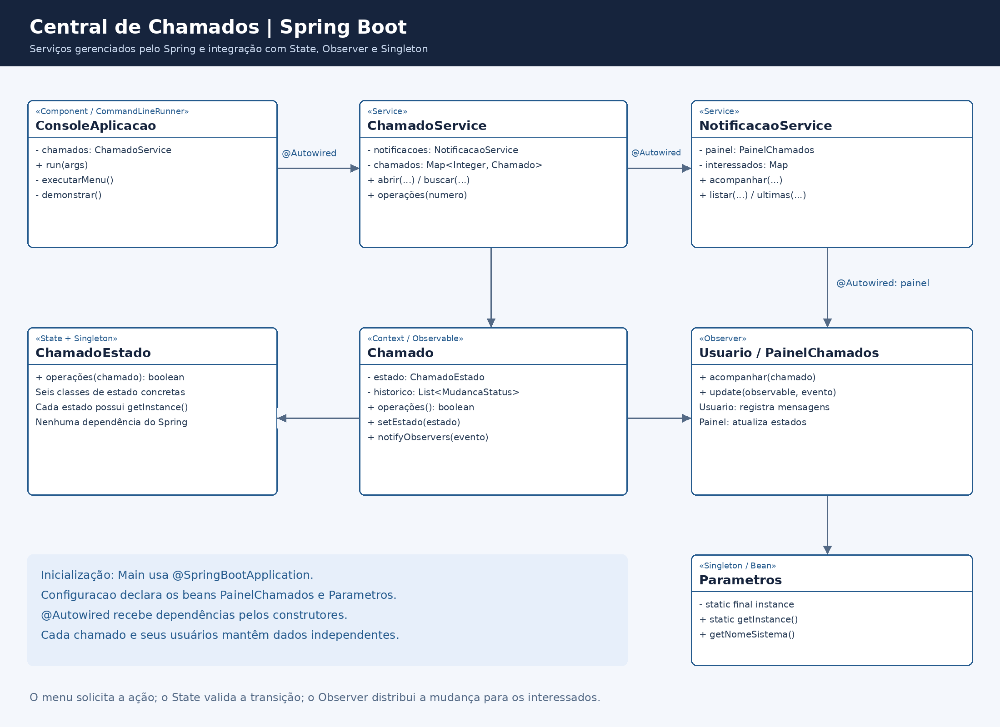
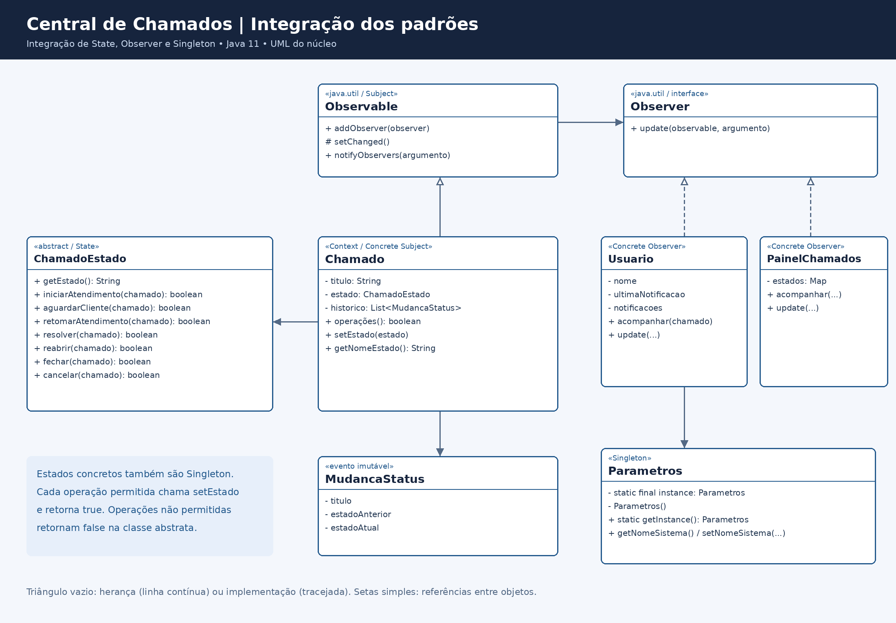
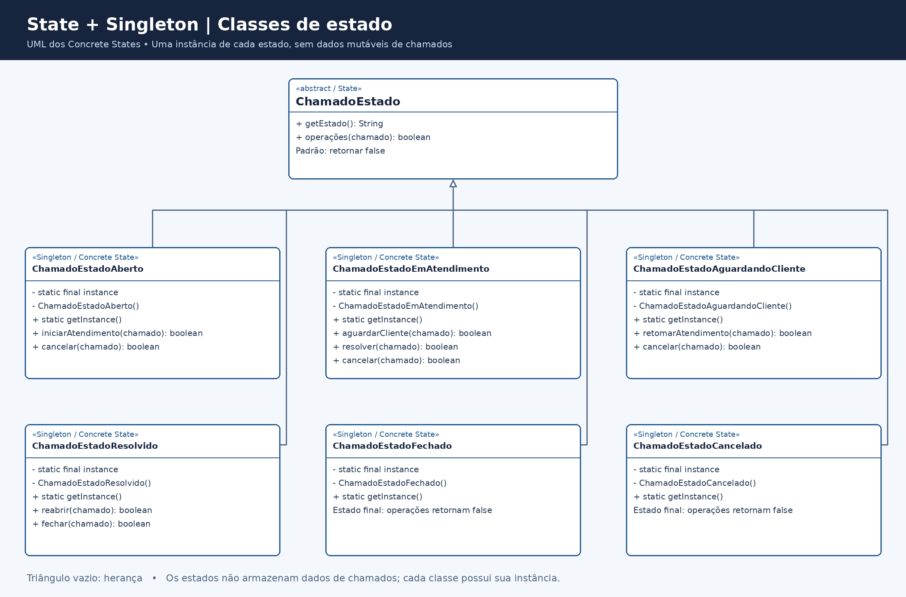

# Central de Chamados

Aplicação Java com Spring Boot para acompanhamento de chamados de suporte, utilizando State, Observer e Singleton.

## Tecnologias

- Java 17 ou superior.
- Spring Boot 3.5.16.
- Maven 3.6.3 ou superior.
- JUnit Jupiter e Spring Boot Test, com versões gerenciadas pelo Spring Boot.

## Executar no IntelliJ IDEA

1. Abra a pasta `central-chamados`, que contém `pom.xml`.
2. Configure o Project SDK como JDK 17 ou superior.
3. Importe o `pom.xml` como projeto Maven ou use Reload All Maven Projects.
4. Aguarde a resolução das dependências.
5. Abra `src/main/java/aplicacao/Main.java` e execute `Main.main()`.
6. Use o menu na janela Run.

A aplicação funciona no console. Não é necessário abrir um navegador ou configurar um servidor web.
Se a IDE ainda exibir imports do Spring em vermelho, verifique o SDK e conclua a importação Maven.

## Executável incluído

Com Java 17 ou superior:

```powershell
java -jar executavel/central-chamados.jar
```

Demonstração automática:

```powershell
java -jar executavel/central-chamados.jar --demo
```

O JAR inclui as dependências do Spring Boot. Para executar esse arquivo já compilado, não é necessário instalar o Maven.

## Compilar e testar

Na pasta que contém `pom.xml`:

```powershell
mvn clean test
mvn package
java -jar target/central-chamados-1.0.0.jar
```

Também é possível executar `mvn spring-boot:run`.

Os scripts `executar.ps1` e `executar.sh` compilam com Maven e iniciam a aplicação.
No Windows: `powershell -NoProfile -ExecutionPolicy Bypass -File .\executar.ps1`.
Para executar apenas os testes: `.\testar.ps1` ou `mvn test`.
A primeira compilação exige acesso à internet para baixar dependências.

## Organização

| Pacote | Responsabilidade |
|---|---|
| `aplicacao` | Inicialização Spring Boot, configuração de beans e menu de console |
| `servicos` | Gerenciamento de chamados e acompanhamento das notificações |
| `padroescomportamentais.state` | Contexto, estados concretos e evento de mudança |
| `padroescomportamentais.observer` | Usuários interessados e painel de acompanhamento |
| `padroescriacao.singleton` | Parâmetros compartilhados do sistema |

Os testes reproduzem os pacotes das classes em `src/test/java`.

## Injeção de dependências

`Main` utiliza `@SpringBootApplication` para inicializar o contexto Spring.

`ChamadoService` e `NotificacaoService` são anotados com `@Service`. O Spring cria e gerencia esses objetos.
Os construtores usam `@Autowired` para receber suas dependências:

```java
@Service
public class ChamadoService {
    private final NotificacaoService notificacoes;

    @Autowired
    public ChamadoService(NotificacaoService notificacoes) {
        this.notificacoes = notificacoes;
    }
}
```

`ConsoleAplicacao` é um `@Component` que implementa `CommandLineRunner` e recebe o serviço de chamados por construtor.
`Configuracao` declara os beans de `PainelChamados` e `Parametros`.

A injeção de dependências organiza a construção e a ligação dos componentes. Os imports continuam sendo necessários para referenciar classes e anotações de outros pacotes.
`@Autowired` injeta dependências; não implementa autenticação ou autorização.

## Padrões de projeto

| Padrão | Aplicação |
|---|---|
| State | Cada estado define quais operações do chamado são permitidas |
| Observer | A mudança do chamado notifica seus usuários e atualiza o painel |
| Singleton | Estados reutilizáveis e configuração única de `Parametros` |

Os serviços Spring possuem escopo singleton por padrão dentro do contexto da aplicação.
As classes de estado e `Parametros` também demonstram explicitamente o padrão Singleton com construtor privado e `getInstance()`.
Chamados e usuários são instanciados por cadastro, pois representam dados independentes.

## Fluxo dos chamados

| Estado atual | Ações permitidas e destino |
|---|---|
| Aberto | iniciarAtendimento → Em atendimento; cancelar → Cancelado |
| Em atendimento | aguardarCliente → Aguardando cliente; resolver → Resolvido; cancelar → Cancelado |
| Aguardando cliente | retomarAtendimento → Em atendimento; cancelar → Cancelado |
| Resolvido | reabrir → Em atendimento; fechar → Fechado |
| Fechado | Estado final |
| Cancelado | Estado final |

As transições permitidas retornam `true`; as recusadas retornam `false` e não produzem eventos.
O método `setEstado` centraliza a alteração, o histórico e as notificações.
A criação estabelece o estado inicial sem notificar uma mudança.

## Funcionalidades

- Criar chamados com título, solicitante e técnico/equipe.
- Listar e selecionar chamados pelo número.
- Iniciar, aguardar cliente, retomar, resolver, reabrir, fechar e cancelar.
- Mostrar as notificações dos dois interessados imediatamente após cada mudança válida.
- Consultar o histórico e as notificações do chamado selecionado.
- Consultar o painel de acompanhamento de todos os chamados.

Os interessados são cadastrados separadamente para cada chamado; uma alteração não notifica usuários de outro chamado.

Exemplo:

```text
[Central de Chamados] Ana, Chamado 'Falha no acesso': Aberto -> Em atendimento
```

## Configuração

Em `src/main/resources/application.properties`:

```properties
app.nome=Central de Chamados
app.console.enabled=true
```

`app.nome` define o nome usado nas notificações. `app.console.enabled=false` desativa o menu, permitindo testar o contexto Spring sem ler o teclado.

## Testes

A suíte contém **76 testes**, cobrindo transições, observadores, Singleton, serviços e inicialização do contexto Spring. Todos passaram na execução de `mvn clean package`.
Os testes Spring usam `@SpringBootTest` e desativam o menu com `app.console.enabled=false`.
Os testes dos padrões continuam sendo executados sem carregar o Spring.

## Diagramas







O modelo editável está em `docs/diagrama-completo.puml` e as decisões técnicas em `docs/ARQUITETURA.md`.

## Escopo

Aplicação de console com armazenamento em memória e uso sequencial. Os dados são descartados ao encerrar.
Não há endpoints HTTP, banco de dados, envio de e-mail, autenticação ou autorização.

O Observer utiliza `Observable`/`Observer`, APIs presentes no Java e marcadas como deprecated. A publicação segue o comportamento padrão dessas classes, sem ordem garantida ou isolamento de falhas de observadores externos.

`setEstado` permanece público para configuração técnica e preparação dos testes. As regras de negócio são aplicadas pelas operações de transição; o menu e os serviços usam essas operações.
